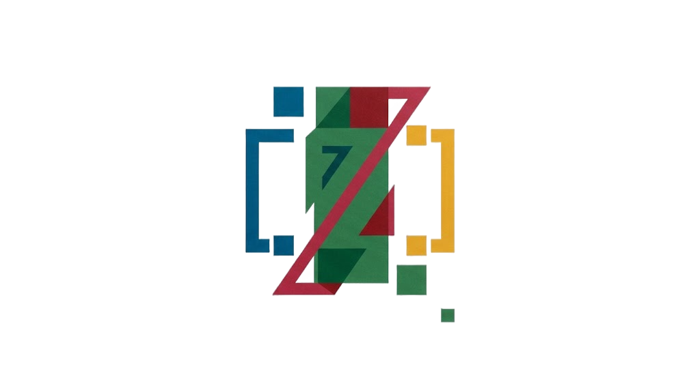

<div align="center">
  
  <p>
    <strong>The fluent, zero-cost terminal styling toolkit for Rust.</strong><br/>
    Zero dependencies · <code>Copy</code> styles · allocation-free rendering · multi-segment lines · gradients · panels · hyperlinks · capability detection · ANSI-aware text tools
  </p>
  <p>
    
    
    
    
    
    
    
  </p>
</div>

---

`pretty-console` v2 makes terminal output pleasant to write and to read: build styled spans with a fluent API, compose them into lines, decorate with gradients and panels, degrade colors for limited terminals, and measure, truncate and pad strings exactly the way a terminal renders them — all without pulling in a single dependency.

## Highlights

- **Fluent builder** — `Span::new("hi").red().bold()`, plus the [`Styled`] trait to paint literals in place: `"hello".green()`
- **`Copy` styles, zero allocation** — a `Style` is a small `Copy` struct (no `Vec` of attributes), buildable in `const` context; `Display` writes ANSI codes straight into the destination formatter
- **Composition** — [`Line`] joins differently-styled `Span`s into one row: the multi-segment output every CLI needs
- **Decorations** — [`gradient`], [`rainbow`], rounded [`Panel`] boxes with inlaid titles, OSC 8 hyperlinks (`Span::link`)
- **Adaptive colors** — detect terminal capability (`COLORTERM`, `FORCE_COLOR=1/2/3`, `TERM`) with [`supports_color_level`] and degrade truecolor via `render_with`
- **ANSI-aware text toolkit** — [`strip_ansi`], [`visible_width`] (CJK-aware), [`truncate`] with ellipsis, [`pad`]
- **Rich colors** — 16 named, full 256-palette, 24-bit RGB, packed hex, *and* hex strings (`"#7c4dff"`)
- **Ergonomics** — idempotent attributes (`.bold().bold()` emits one code), `when(condition, …)` conditional styling, `paint!`/`style!`/`line!` macros
- **Runtime color control** — `NO_COLOR`, `CLICOLOR`, `CLICOLOR_FORCE`, `FORCE_COLOR`, `TERM=dumb` honored with a cached decision (zero syscalls on the hot path); stderr + fallible `try_*` printers
- **Contrast helpers** — `Color::luminance`, `Color::readable_on` (WCAG 4.5:1 crossover)
- **`no-color` feature** — compile out all styling entirely

## Quick start

```sh
cargo add pretty-console
```

```rust
use pretty_console::{Line, Span, Styled};

fn main() {
    Span::new("Hello, world!").red().bold().println();
    println!("{}", "Ready to go".cyan());

    // Multi-segment status lines, left to right.
    Line::new()
        .push("  build ").dim()
        .push("cargo build --release").bold()
        .push(" finished in ").push("4.2s").green()
        .println();
}
```

## Usage

### Reusable styles and merging

```rust
use pretty_console::{Color, Span, Style};

let heading = Style::new().bold().underline().fg(Color::BRIGHT_BLUE);
heading.paint("Chapter 1").println();
heading.paint("Chapter 2").println();

// Colors of `other` win; attribute sets union (no duplicate codes).
let emphasis = Style::new().fg(Color::RED);
heading.merge(emphasis).paint("Important").println();
```

### Hex colors, parsing and contrast

```rust
use pretty_console::{Color, Span, Styled};

Span::new("Violet").fg(Color::hex(0x7C_4D_FF)).println();

// From config files / CLI flags:
if let Ok(color) = Color::from_hex_str("#22d3ee") {
    Span::new("theme accent").fg(color).println();
}

// Pick a readable foreground for an arbitrary background (WCAG 4.5:1).
let bg = Color::hex(0x1E293B);
Span::new("readable").bg(bg).fg(bg.readable_on()).println();
```

### Log levels, banners and panels

```rust
use pretty_console::{Line, Panel, Span, Style};

Span::info("Compiling 42 modules").println();  // [INFO] …, cyan
Span::success("Tests passed").println();       // [OK] …, bold green
Span::warn("Deprecated API").println();        // [WARN] …, yellow
Span::error("Disk full").println();            // [ERROR] …, bold red
Span::debug("cache_size = 42").println();      // [DEBUG] …, dim

Span::banner("Build report", 60).println();

Panel::new()
    .title("Summary")
    .border(Style::new().bright_black())
    .line(Line::new().push("passed: ").dim().push("128").green().bold())
    .println();
```

### Gradients and rainbows

```rust
use pretty_console::{gradient, rainbow, Color};

gradient("sunrise fade", Color::hex(0xFF3E6C), Color::hex(0x4DC4FF)).println();
rainbow("the full spectrum, one hue per character").println();
```

### Hyperlinks

```rust
use pretty_console::Span;

Span::new("documentation")
    .blue()
    .underline()
    .link("https://docs.rs/pretty-console")
    .println();
```

### Adaptive colors for limited terminals

```rust
use pretty_console::{ColorLevel, Span, Styled};

let fancy = "truecolor text".fg_hex(0x7C_4D_FF);
println!("{}", fancy.render_with(ColorLevel::Ansi256)); // degrades to the nearest palette entry
println!("{}", fancy.render_with(ColorLevel::Ansi16));  // degrades to the nearest of the 16 base colors
```

`supports_color_level()` detects what the current terminal supports (honoring `FORCE_COLOR=1/2/3`, `COLORTERM`, `TERM`).

### ANSI-aware text tools

```rust
use pretty_console::{pad, truncate, visible_width, Align, Styled};

assert_eq!(truncate("hello world", 8, "…"), "hello w…");
assert_eq!(visible_width("日本語"), 6);          // wide chars = 2 columns
assert_eq!(pad("hi", 4, Align::Right, '.'), "..hi");
assert_eq!(visible_width(&"hi".red().to_string()), 2); // escapes are zero-width
```

### Runtime color control

Printing honors the global `ColorChoice` (set it from your own `--color` flag):

| Choice | Behavior |
| --- | --- |
| `Auto` (default) | Honors the variables below, then stdout tty detection — decision is cached |
| `Always` | Always emit colors |
| `Never` | Never emit colors |

| Variable | Effect |
| --- | --- |
| `FORCE_COLOR` | `0` off; `1`/`2`/`3` → 16/256/truecolor (Node.js convention) |
| `CLICOLOR_FORCE` | Non-`0` forces colors on |
| `NO_COLOR` | Non-empty disables colors |
| `CLICOLOR` | `0` disables colors |
| `TERM` | `dumb` disables colors; also used for capability detection |
| `COLORTERM` | `truecolor`/`24bit` enables truecolor capability |

> [!NOTE]
> String rendering (`to_string`, `Display`, `render`) is deterministic and never consults
> the environment or a terminal — only the print family does. Formatted output is
> identical whether it is produced on a CI runner or in an interactive terminal.

### Macros

```rust
use pretty_console::{paint, style};

paint!(green bold, "{} tests passed", 12).println();
style!(dim italic).paint("press q to quit").println();
```

### The `no-color` feature

```toml
[dependencies]
pretty-console = { version = "2.0.0", features = ["no-color"] }
```

All ANSI generation is compiled out; every method still exists and behaves as a pass-through. `strip_ansi`, `visible_width`, `truncate`, `pad` and `Panel` keep working.

## Comparison

| Feature | pretty-console | owo-colors | colored | yansi | termcolor |
| --- | --- | --- | --- | --- | --- |
| Zero dependencies | ✅ | ✅ | ✅ | ✅ | ❌ |
| `Copy` + `const` styles | ✅ | ✅ | ❌ | ✅ | ❌ |
| Multi-segment lines | ✅ | ❌ | ❌ | ❌ | ❌ |
| Gradients / rainbow | ✅ | ❌ | ❌ | ❌ | ❌ |
| Panels / boxes | ✅ | ❌ | ❌ | ❌ | ❌ |
| Hyperlinks (OSC 8) | ✅ | ❌ | ❌ | ❌ | ❌ |
| Capability detection + degradation | ✅ | via `supports-color` | ❌ | ❌ | ❌ |
| Hex-string parsing | ✅ | ❌ | ✅ | ❌ | ❌ |
| CJK-aware width, truncate, pad | ✅ | ❌ | ❌ | ❌ | ❌ |
| Conditionals + macros | ✅ | partial | ❌ | ✅ | ❌ |
| `unsafe` forbidden | ✅ | ✅ | ✅ | ✅ | ❌ |

## Performance

Rendering writes SGR codes straight into the destination `Formatter` — no intermediate `String` in `write!`/`print!` paths, no per-style heap allocation, no env syscalls after the first print.

Measured with the in-repo micro-benchmark (`cargo run --release --example bench`, styled string with 3 attributes, 200k iterations; numbers from a CI-class Linux VM, relative to pretty-console):

| Operation | pretty-console | owo-colors | yansi | colored |
| --- | --- | --- | --- | --- |
| `to_string()` | 6.2M ops/s | 7.6M ops/s | 6.5M ops/s | 12.7M ops/s* |
| `write!` into a buffer | 9.7M ops/s | 12.6M ops/s | — | — |
| `strip_ansi` | 1.6 GB/s | — | — | — |

\* `colored`'s `Display` does not honor width/formatting and its colored output includes precomputed codes for these fixed colors; for RGB/256-color styles the gap closes. All three libraries are within the same order of magnitude — the differences that matter in practice are allocation behavior (pretty-console and owo-colors are alloc-free in the `write!` path) and feature depth.

## Platform support

- **Unix-like systems**: full support via ANSI escape codes
- **Windows 10+**: full support through virtual terminal sequences

## Migrating from 1.x

- `Console` is now a deprecated alias of [`Span`] — existing `Console::new(...).red().println()` code keeps compiling.
- Attribute codes are emitted in **canonical order** (bold → strikethrough), not insertion order; duplicates are removed. Exact-output snapshot tests may need updating.
- `Style::attributes()` returns an `Effects` bitset instead of `&[Attribute]`; `Style` is now `Copy`.
- `Console::new_with_style` is kept; the Span-native spelling is `Span::new_with_style` / `Style::paint`.
- The `insta` dev-dependency was replaced by exact-string contract tests; rendering determinism guarantees are unchanged.

## License

MIT — see [LICENSE-MIT](LICENSE-MIT).

[`Styled`]: https://docs.rs/pretty_console/latest/pretty_console/trait.Styled.html
[`Line`]: https://docs.rs/pretty_console/latest/pretty_console/struct.Line.html
[`Span`]: https://docs.rs/pretty_console/latest/pretty_console/struct.Span.html
[`Panel`]: https://docs.rs/pretty_console/latest/pretty_console/struct.Panel.html
[`gradient`]: https://docs.rs/pretty_console/latest/pretty_console/fn.gradient.html
[`rainbow`]: https://docs.rs/pretty_console/latest/pretty_console/fn.rainbow.html
[`supports_color_level`]: https://docs.rs/pretty_console/latest/pretty_console/fn.supports_color_level.html
[`strip_ansi`]: https://docs.rs/pretty_console/latest/pretty_console/fn.strip_ansi.html
[`visible_width`]: https://docs.rs/pretty_console/latest/pretty_console/fn.visible_width.html
[`truncate`]: https://docs.rs/pretty_console/latest/pretty_console/fn.truncate.html
[`pad`]: https://docs.rs/pretty_console/latest/pretty_console/fn.pad.html
